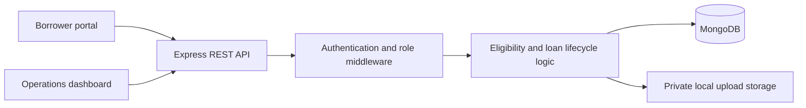
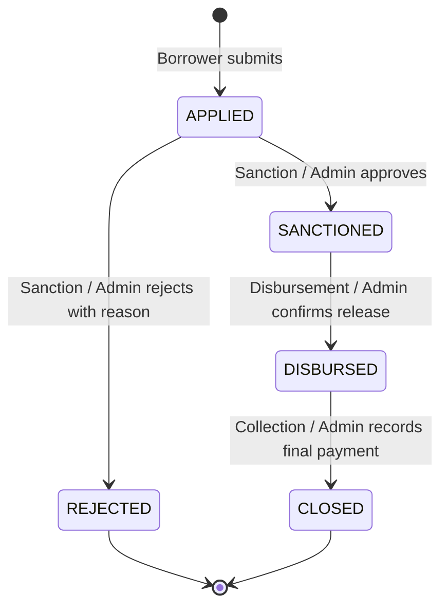

# Lumen — Loan Management System

A full-stack lending platform that connects borrower applications with internal loan operations. Borrowers submit personal details, verify eligibility, upload income documentation, and request a loan. Internal teams review applications, release approved funds, and record repayments through role-specific workspaces.

## Video Demo

Access drive link - https://drive.google.com/file/d/1U5ClSKw2Pey7FDts-71poQk1FHVb9_ad/view?usp=sharing

## Contents

- [Features](#features)
- [Technology stack](#technology-stack)
- [Architecture](#architecture)
- [Getting started](#getting-started)
- [Environment configuration](#environment-configuration)
- [Evaluator credentials](#evaluator-credentials)
- [Borrower journey](#borrower-journey)
- [Loan lifecycle and access control](#loan-lifecycle-and-access-control)
- [Data model and payment handling](#data-model-and-payment-handling)
- [API overview](#api-overview)
- [Scripts and verification](#scripts-and-verification)
- [Deployment](#deployment)
- [Current scope and limitations](#current-scope-and-limitations)

## Features

### Borrower Portal

- Registration and login with JWT sessions and bcrypt password hashing.
- A multi-step application that resumes from saved progress.
- Server-side eligibility checks with clear validation errors.
- Salary-slip uploads supporting PDF, JPG, and PNG.
- Loan amount and tenure sliders with a live simple-interest calculation.
- Application status, activity timeline, payment history, and repayment progress.

### Operations Dashboard

| Module | Responsibility |
| --- | --- |
| Sales | Track registered borrowers who have not applied |
| Sanction | Review applications, approve loans, or reject with a reason |
| Disbursement | Confirm release of funds for sanctioned loans |
| Collection | Record payments, track balances, and view closed loans |

The dashboard includes a role-scoped overview, searchable queues, filters, pagination, CSV exports, and contextual action dialogs. Admins can access all modules; executives can access their assigned module. Borrowers use the application portal.

## Technology Stack

| Layer | Technologies |
| --- | --- |
| Frontend | Next.js 16 App Router, React 19, TypeScript, Tailwind CSS 4, Lucide React |
| Backend | Node.js, Express 5, TypeScript |
| Database | MongoDB with Mongoose |
| Authentication | JWT, bcrypt, HttpOnly cookies |
| Validation and uploads | Zod, Multer |
| API protection | Helmet, CORS, rate limiting, browser-origin checks |
| Backend testing | Node.js test runner, Supertest, isolated MongoDB test instances |

## Architecture



Application code is organized into two top-level folders:

```text
Loan-Management-System/
├── README.md
├── frontend/
│   ├── src/
│   │   ├── app/
│   │   │   ├── login/             # Sign-in and registration
│   │   │   ├── portal/            # Borrower application and loan tracking
│   │   │   └── dashboard/
│   │   │       └── [module]/      # Role-specific operations screens
│   │   ├── components/           # Authentication, navigation, shared UI
│   │   └── lib/                  # API client, types, formatting, exports
│   ├── .env.example
│   └── README.md
└── backend/
    ├── src/
    │   ├── middleware/           # Authentication and RBAC
    │   ├── models/               # User and Loan schemas
    │   ├── routes/               # Auth, borrower, and team endpoints
    │   ├── services/             # Eligibility and financial calculations
    │   ├── database.ts           # MongoDB connection and optional DNS setup
    │   ├── seed.ts               # Evaluator accounts and sample records
    │   └── server.ts             # API startup and shutdown
    ├── scripts/                  # Local demo launcher
    ├── tests/                    # Eligibility and lifecycle tests
    ├── .env.example
    └── README.md
```

See the [frontend guide](frontend/README.md) and [backend guide](backend/README.md) for implementation details.

## Getting Started

### Prerequisites

- Node.js 20.9 or later and npm.
- Local MongoDB or a MongoDB Atlas connection for standard startup.
- Internet access for installing dependencies and the first demo/test MongoDB binary download.

The commands below use PowerShell and assume the current directory is the project root.

### 1. Install Dependencies

```powershell
cd backend
npm install
cd ../frontend
npm install
cd ..
```

### 2. Configure Environment Files

Create these files only if they do not already exist:

```powershell
Copy-Item backend/.env.example backend/.env
Copy-Item frontend/.env.example frontend/.env.local
```

Set `MONGODB_URI` to your database connection string. Replace the backend `JWT_SECRET` placeholder with a random secret of at least 32 characters. Generate a value with:

```powershell
node -e "console.log(require('node:crypto').randomBytes(48).toString('hex'))"
```

Copy the generated value into `backend/.env`. Keep environment files and database credentials out of version control.

### 3. Seed and Start the Backend

With your local MongoDB running or Atlas configured:

```powershell
cd backend
npm run seed
npm run dev
```

The API runs at **http://localhost:4000**. Check database readiness at **http://localhost:4000/api/health**.

### 4. Start the Frontend

In a separate terminal, from the project root:

```powershell
cd frontend
npm run dev
```

Open **[http://localhost:3000](http://localhost:3000)** and sign in with a seeded account or register as a borrower.

### Alternative: Demo Without Installing MongoDB

After installing dependencies and setting a valid `JWT_SECRET`, replace the standard backend startup with:

```powershell
cd backend
npm run demo
```

The launcher starts a real local MongoDB process on port **27018**, creates role accounts, and starts the API. It uses its own database URI instead of the configured `MONGODB_URI`. Data persists in `backend/.local-data`, and salary slips persist in MongoDB. Start the frontend separately.

Do not run backend `demo` and `dev` simultaneously. Stop the processes with Ctrl+C. The demo launcher is intended for local evaluation.

## Environment Configuration

### Backend — `backend/.env`

| Variable | Default / requirement | Purpose |
| --- | --- | --- |
| `PORT` | `4000` | Express API port |
| `MONGODB_URI` | `mongodb://127.0.0.1:27017/lumen` | Database connection string |
| `MONGODB_DNS_SERVERS` | Optional; blank uses system DNS | Comma-separated DNS IPs for MongoDB SRV/TXT resolution |
| `JWT_SECRET` | Required; at least 32 characters | JWT signing secret |
| `FRONTEND_URL` | `http://localhost:3000` | Allowed browser origin |
| `NODE_ENV` | `development` locally | Enables Secure cookies when set to `production` |

Optional custom DNS example:

```dotenv
MONGODB_DNS_SERVERS=1.1.1.1,8.8.8.8
```

DNS configuration is applied before MongoDB connects, including during seeding. Invalid addresses stop startup with a configuration error.

### Frontend — `frontend/.env.local`

| Variable | Default | Purpose |
| --- | --- | --- |
| `NEXT_PUBLIC_API_URL` | `http://localhost:4000/api` | Backend API base URL, including `/api` |

The frontend also reads `.env`; `.env.local` takes precedence. Restart development servers after configuration changes. Production changes to `NEXT_PUBLIC_API_URL` require rebuilding the frontend. Never put secrets in `NEXT_PUBLIC_*` variables.

## Evaluator Credentials

Run the seed against the database used by the backend before signing in.

**Password for all accounts: `Lumen@123`**

| Role | Email | Workspace |
| --- | --- | --- |
| Admin | `admin@lumen.test` | All operations modules |
| Sales | `sales@lumen.test` | Pre-application borrower leads |
| Sanction | `sanction@lumen.test` | Application review |
| Disbursement | `disbursement@lumen.test` | Sanctioned loan release |
| Collection | `collection@lumen.test` | Active loans and repayments |
| Borrower | `borrower@lumen.test` | Borrower application portal |

The login screen provides role shortcuts that fill these credentials. On a fresh seed, the Borrower account has no submitted loan so evaluators can test the complete journey. Sample records populate the operations queues.

Seeding is additive and preserves existing accounts and loans. These known credentials are for evaluation; do not seed them into a public production database.

## Borrower Journey

### Step 1 — Register or Sign In

Public registration creates a Borrower account. Passwords are bcrypt-hashed at cost 12. Authentication creates an eight-hour JWT session in an HttpOnly, SameSite=Lax cookie.

### Step 2 — Personal Details and Eligibility

Collect full name, PAN, date of birth, monthly salary, and employment mode.

| Rule | Requirement |
| --- | --- |
| Age | Between 23 and 50 completed years, inclusive |
| Monthly salary | At least ₹25,000 |
| PAN | Matches `^[A-Z]{5}[0-9]{4}[A-Z]$` after normalization |
| Employment | Salaried or Self-Employed; Unemployed is rejected |

All rules must pass. The server checks eligibility when saving details and again at submission. Failed checks return clear errors and block progress. Browser controls guide input; server validation remains authoritative because client checks can be bypassed.

PAN validation checks the character pattern, not government records or ownership.

### Step 3 — Upload Salary Slip

Accept PDF, JPG/JPEG, or PNG with a limit of **5 MiB (5 × 1024 × 1024 bytes)**. The server validates the extension, MIME type, and signature before saving a randomly named file in `backend/uploads`.

Document metadata is stored on the borrower record, which the loan references. Downloads require authorization: the owning borrower, Sanction, or Admin.

### Step 4 — Configure and Apply

| Term | Value |
| --- | --- |
| Loan amount | ₹50,000–₹5,00,000 |
| Tenure | 30–365 whole days |
| Interest rate | Fixed at 12% per year |

The sliders update the calculation panel immediately:

```text
Simple Interest = (Principal × Rate × Tenure in days) / (365 × 100)
Total Repayment = Principal + Simple Interest
```

For example, ₹1,00,000 over 365 days incurs ₹12,000 interest, for a total repayment of ₹1,12,000. Interest is rounded to the nearest paise. The server calculates authoritative terms and creates the loan with status `APPLIED`, representing pending review.

## Loan Lifecycle and Access Control



| Role | Permitted actions |
| --- | --- |
| Borrower | Manage their draft, submit a request, and view their loan |
| Sales | View borrowers who have registered but not applied |
| Sanction | Review applied loans, approve, or reject with a reason |
| Disbursement | Confirm release of funds for sanctioned loans |
| Collection | Record repayments for disbursed loans and view closed loans |
| Admin | Access all operations modules and their actions |

The repayment due date is set at disbursement plus the selected tenure. APIs reject invalid transitions and do not permit stage skipping or reversal.

Frontend layouts and module checks restrict navigation and rendering. Backend middleware independently loads the current role from MongoDB and enforces access. Missing or expired authentication returns **401**; authenticated users with an unauthorized role receive **403**.

## Data Model and Payment Handling

| Collection | Contents and relationships |
| --- | --- |
| Users | Name, unique email, hidden password hash, role, personal details, salary-slip metadata, timestamps |
| Loans | Unique borrower reference, loan reference, financial terms, status, stage dates, rejection reason, embedded payments, audit history |

Payments are embedded in the loan so payment insertion, balance adjustment, and closure happen in one atomic document update. Money is stored as integer paise.

```text
Outstanding balance = Total repayment − Total paid
```

Each payment requires:

- A positive amount with at most two decimal places.
- An amount no greater than the outstanding balance.
- A valid date on or after disbursement and no later than today in Asia/Kolkata.
- A unique 6–40 character alphanumeric/hyphen UTR, normalized to uppercase.

A unique MongoDB index prevents UTR reuse across loans; an update filter prevents reuse within the same loan. A balance comparison protects against concurrent overpayment. When total paid equals total repayment, the same update sets `CLOSED`. Further payments on closed loans are rejected.

## API Overview

All endpoints are prefixed with `/api`. Requests use JSON except document uploads, which use multipart form data with the field `file`.

| Method | Endpoint | Purpose |
| --- | --- | --- |
| POST | `/auth/register` | Register a borrower |
| POST | `/auth/login` | Create a session |
| POST | `/auth/logout` | Clear the session |
| GET | `/auth/me` | Get the current user |
| GET | `/borrower/application` | Get saved application details and loan |
| PUT | `/borrower/personal` | Validate and save personal details |
| POST | `/borrower/salary-slip` | Upload an income document |
| POST | `/borrower/loans` | Submit a loan request |
| GET | `/sales/leads` | List borrowers without applications |
| GET | `/sanction/loans` | List applied and rejected loans |
| PATCH | `/sanction/loans/:id/decision` | Approve or reject an application |
| GET | `/disbursement/loans` | List sanctioned loans |
| PATCH | `/disbursement/loans/:id/disburse` | Confirm funds released |
| GET | `/collection/loans` | List disbursed and closed loans |
| POST | `/collection/loans/:id/payments` | Record a repayment |
| GET | `/operations/overview` | Get a role-scoped portfolio |
| GET | `/documents/:userId` | Download an authorized salary slip |
| GET | `/health` | Check database readiness |

Success responses expose `user`, `loan`, `loans`, or `leads` as appropriate. Errors use `{ message, failures? }`. Validation errors return 422; duplicate records and conflicting transitions return 409.

Full request contracts, access rules, and status codes are in the [backend API guide](backend/README.md#rest-api).

## Scripts and Verification

### Backend

| Command | Purpose |
| --- | --- |
| `npm run dev` | Start the API with file watching |
| `npm run demo` | Start local MongoDB, seed, and launch the API |
| `npm run seed` | Add evaluator accounts and sample records |
| `npm test` | Run isolated backend tests |
| `npm run build` | Compile TypeScript to `dist` |
| `npm start` | Run the compiled API |

### Frontend

| Command | Purpose |
| --- | --- |
| `npm run dev` | Start Next.js development |
| `npm run typecheck` | Check TypeScript without emitting files |
| `npm run build` | Generate the production build |
| `npm start` | Serve the production build |

Run verification from the project root:

```powershell
cd backend
npm test
npm run build
cd ../frontend
npm run build
```

The backend suite covers role isolation, password hashing, registration role restrictions, eligibility boundaries, upload limits, lifecycle transitions, loan calculations, duplicate UTRs, payment validation, concurrent final payments, rejection, and logout/origin protection. Tests use a temporary database and upload directory rather than the configured application database.

Both production builds and all seven backend tests passed during the project review. Interactive browser and visual verification were unavailable. Build checks do not replace manual testing of forms, navigation, dialogs, exports, and responsive layouts.

## Deployment

1. Configure a private MongoDB connection and a strong JWT secret.
2. Set backend `NODE_ENV=production` and the intended `FRONTEND_URL`.
3. Set frontend `NEXT_PUBLIC_API_URL` before building.
4. Build both applications and run `npm start` in each directory.
5. Serve the frontend and API over HTTPS on the same site for the default cookie policy.
6. Salary slips persist in MongoDB. Preserve `backend/uploads` only for legacy local documents.

Production cookies require HTTPS. The default configuration does not support cross-site frontend/API cookie deployments. Use standard database startup rather than the demo launcher in production.

## Current Scope and Limitations

- One submitted loan per borrower is supported. Multiple loans and reapplication after rejection are not implemented.
- Disbursement confirms funds were released; it does not initiate a bank transfer. Collection records reported payments rather than verifying them through a payment gateway.
- Personal details and documents are linked through the borrower record. Immutable application snapshots are not yet implemented.
- A review identified a race between draft edits and submission: an edit started before submission could finish afterward. Atomic edit/submission locking remains an improvement.
- Age calculations use the UTC calendar date. Using Asia/Kolkata consistently would resolve birthday-boundary differences around local midnight.
- PAN checks validate the character pattern only. File signatures do not provide full document parsing or malware scanning.

For further details, see [backend/README.md](backend/README.md) and [frontend/README.md](frontend/README.md).

## Live application data

The seed creates only the six role accounts; it does not create sample borrowers, loans, payments, or salary slips. Dashboard totals and tables use MongoDB-backed API records. The login page provides role shortcuts for all six evaluator accounts. The seed creates accounts only, without sample loan activity.

To remove fixtures from an earlier seed, run `npm run clean:demo` inside `backend`. Cleanup targets known seed identities and references, preserves other borrowers and loans, and keeps the role accounts. It uses the database configured in `backend/.env`.

## Session routing

Browser API and document requests use `/api` on the frontend domain. Next.js rewrites forward them to Express while keeping the HttpOnly session cookie on the frontend origin. Set frontend `BACKEND_API_URL=https://lms-backend-seven-pied.vercel.app/api` for production (or `http://localhost:4000/api` for development); the existing `NEXT_PUBLIC_API_URL` is also supported as the upstream setting. Backend `FRONTEND_URL` must match the exact frontend origin, and `NODE_ENV=production` must be set on the deployed backend. Redeploy the frontend after changing the upstream URL. Registration/login verifies the session before opening the portal.
